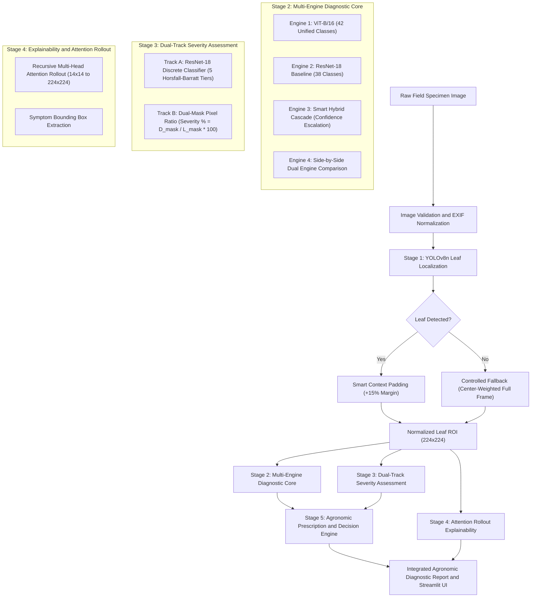

# Precision Crop Pathology and Agronomic Decision Support System

> An End-to-End Hierarchical Deep Learning and Vision Transformer Pipeline for Real-World Foliar Disease Localization, Diagnosis, Dual-Track Severity Grading, and Actionable Agronomic Prescriptions across 42 Pathological Classes and 15 Crop Species.

[](https://www.python.org/)
[](https://pytorch.org/)
[](https://github.com/ultralytics/ultralytics)
[](https://arxiv.org/abs/2010.11929)
[](https://streamlit.io/)
[-success.svg?logo=github)](https://github.com/26piyush/Deep_Learning_Project/releases/tag/v1.0.0)

---

## Table of Contents
1. [Project Overview and Problem Formulation](#1-project-overview-and-problem-formulation)
2. [System Architecture](#2-system-architecture)
   - [Pipeline Flowchart](#pipeline-flowchart)
   - [Detailed Structural Dataflow Diagram](#detailed-structural-dataflow-diagram)
3. [Component-by-Component Technical Breakdown](#3-component-by-component-technical-breakdown)
   - [Stage 1: Hierarchical Localization and Smart Context Cropping](#stage-1-hierarchical-localization-and-smart-context-cropping)
   - [Stage 2: Multi-Engine Foliar Diagnosis (ViT-B/16 and ResNet-18)](#stage-2-multi-engine-foliar-diagnosis-vit-b16-and-resnet-18)
   - [Stage 3: Dual-Track Severity Assessment](#stage-3-dual-track-severity-assessment)
   - [Stage 4: Attention Rollout Explainability](#stage-4-attention-rollout-explainability)
   - [Stage 5: Agronomic Prescription and Treatment Engine](#stage-5-agronomic-prescription-and-treatment-engine)
4. [Taxonomy of Supported Crops and Pathological Classes](#4-taxonomy-of-supported-crops-and-pathological-classes)
5. [Multi-Dataset Engineering and Zero Data Leakage Protocols](#5-multi-dataset-engineering-and-zero-data-leakage-protocols)
6. [Empirical Experimental Results and Benchmarks](#6-empirical-experimental-results-and-benchmarks)
7. [Repository File and Directory Structure](#7-repository-file-and-directory-structure)
8. [Installation and Quick Start Guide](#8-installation-and-quick-start-guide)
9. [Model Weights and Checkpoint Downloads](#9-model-weights-and-checkpoint-downloads)
10. [Command-Line Evaluation and Inference](#10-command-line-evaluation-and-inference)
11. [Academic Defense and Viva Voce Documentation](#11-academic-defense-and-viva-voce-documentation)

---

## 1. Project Overview and Problem Formulation

### Limitations of Conventional Deep Learning in Agricultural Vision
Most existing automated plant pathology systems are trained on clean, isolated laboratory specimens and fail when applied to practical agronomic field environments due to four architectural limitations:

1. **Background Overfitting (Shortcut Learning):** Standard Convolutional Neural Networks (CNNs) trained on raw uncropped field imagery routinely correlate predictions with non-foliar artifacts such as soil texture, weed foliage, human hands, irrigation pipes, and diurnal shadow angles rather than true fungal or bacterial lesions.
2. **Absence of Region-of-Interest Localization:** End-to-end global classifiers indicate disease presence but provide no bounding coordinates for leaf boundaries or symptom clusters, preventing automated precision sprayers and agricultural robots from acting upon the leaf.
3. **Absence of Severity Quantification:** A discrete class prediction (*e.g., "Tomato Early Blight"*) offers zero information regarding disease progression. Effective chemical and biological interventions strictly depend on **pathological severity** (leaf area infected vs. viable green canopy).
4. **Laboratory-to-Field Domain Shift:** Models evaluated exclusively on benchmark datasets with uniform artificial backgrounds (*e.g., PlantVillage*) experience massive accuracy degradation when tested against complex, occluded field leaves (*e.g., PlantDoc*).

### Proposed Solution Architecture
To resolve these deficiencies, this repository implements a modular, multi-tier system:
- **Hierarchical Region Extraction:** Employs Ultralytics YOLOv8n to isolate foliar tissue, eliminating over 80% of background noise.
- **Smart Context Boundary Padding:** Expands localized bounding boxes by $+15\%$ padding to ensure marginal chlorotic rings and fungal haloes are fully preserved.
- **Global Multi-Head Attention:** Vision Transformer (`ViT-B/16`, 86.6M parameters) captures global, long-range spatial dependencies across distant lesion margins that local convolutional kernels miss.
- **Dual-Track Severity Assessment:** Evaluates infection stage through both an agronomic 5-tier Horsfall-Barratt classifier and a continuous mathematical pixel necropsy metric ($\frac{D_{\text{mask}}}{L_{\text{mask}}} \times 100\%$).
- **Explainability and Prescription Synthesis:** Visualizes self-attention rollout token heatmaps and translates diagnosis into FRAC-coded chemical fungicide schedules, biological bio-controls, and cultural sanitation measures.

---

## 2. System Architecture

### Pipeline Flowchart



---

### Detailed Structural Dataflow Diagram

```
===================================================================================================
                               INPUT LAYER: FIELD SPECIMEN
===================================================================================================
                                  [ Input Field Image ]
                                            │
                                            ▼
                           ┌─────────────────────────────────┐
                           │      IMAGE PREPROCESSING        │
                           │  • RGB Mode Enforcement         │
                           │  • File Byte Corruption Guard   │
                           │  • EXIF Orientation Fix         │
                           └─────────────────────────────────┘
                                            │
===================================================================================================
                               STAGE 1: LOCALIZATION LAYER
===================================================================================================
                                            │
                                            ▼
                           ┌─────────────────────────────────┐
                           │    Ultralytics YOLOv8n Leaf     │
                           │      and Region Detector        │
                           └─────────────────────────────────┘
                                            │
                       ┌────────────────────┴────────────────────┐
              [ Bounding Box(es) Found ]                  [ No Detection ]
                       │                                         │
                       ▼                                         ▼
         ┌───────────────────────────┐             ┌───────────────────────────┐
         │    SMART CONTEXT CROP     │             │    CONTROLLED FALLBACK    │
         │ • Merge intersecting bboxes│             │ • Full frame center-crop  │
         │ • Add +15% margin padding │             │ • Set fallback flag = True│
         │ • Prevent halo truncation │             │ • Log telemetry advisory  │
         └───────────────────────────┘             └───────────────────────────┘
                       │                                         │
                       └────────────────────┬────────────────────┘
                                            │ (Extracted Foliar ROI: 224×224)
===================================================================================================
                             STAGE 2: MULTI-ENGINE DIAGNOSTIC LAYER
===================================================================================================
                                            │
         ┌──────────────────────────────────┴──────────────────────────────────┐
         │                                                                     │
         ▼                                                                     ▼
┌─────────────────────────────────┐                   ┌─────────────────────────────────┐
│     ENGINE 1: ViT-B/16          │                   │   ENGINE 2: ResNet-18 BASELINE  │
│ • Patch Tokenization (16×16)    │                   │ • 11.2M Parameters              │
│ • 196 Tokens + [x_class]        │                   │ • 38 PlantVillage Classes       │
│ • 12 Multi-Head Self-Attention  │                   │ • 14 Crop Species               │
│ • 86.6M Parameters              │                   │ • Standard Convolutional Head   │
│ • 42 Unified Classes (15 Crops) │                   │ • Fast Edge Execution           │
└────────────────┬────────────────┘                   └────────────────┬────────────────┘
                 │                                                     │
                 ├──────────────────────────┬──────────────────────────┤
                 ▼                          ▼                          ▼
      [ Engine 1: ViT Standalone ] [ Engine 3: Smart Cascade ] [ Engine 4: Side-by-Side ]
      Direct ViT Softmax Probs     ViT if conf >= 0.65;        Concurrent execution with
                                   else escalate to ResNet-18  consensus agreement metric
                                            │
===================================================================================================
                          STAGE 3: DUAL-TRACK SEVERITY ASSESSMENT
===================================================================================================
                                            │
                 ┌──────────────────────────┴──────────────────────────┐
                 │                                                     │
                 ▼                                                     ▼
┌─────────────────────────────────┐                   ┌─────────────────────────────────┐
│     TRACK A: DISCRETE MODEL     │                   │   TRACK B: MATHEMATICAL RATIO   │
│ • ResNet-18 Severity Classifier │                   │ • Dual-Mask Segmentation        │
│ • 5 Horsfall-Barratt Levels:    │                   │ • Leaf Surface Mask (L_mask)    │
│   - No Risk   (0%)              │                   │ • Lesion Symptom Mask (D_mask)  │
│   - Very Low  (1% – 5%)         │                   │ • Physical Area Ratio:          │
│   - Low       (6% – 15%)        │                   │       sum(D_mask)               │
│   - Medium    (16% – 35%)       │                   │   % = ─────────── × 100%        │
│   - High      (> 35%)           │                   │       sum(L_mask)               │
└────────────────┬────────────────┘                   └────────────────┬────────────────┘
                 │                                                     │
===================================================================================================
                    STAGE 4 & 5: EXPLAINABILITY AND PRESCRIPTION SYNTHESIS
===================================================================================================
                 │                                                     │
                 ├──────────────────────────┬──────────────────────────┘
                 │                          │
                 ▼                          ▼
┌─────────────────────────────────┐  ┌─────────────────────────────────┐
│   STAGE 4: ATTENTION ROLLOUT    │  │   STAGE 5: AGRONOMIC ACTION     │
│ • Multi-Head Self-Attention Map │  │ • FRAC-Coded Chemical Fungicide │
│ • Token attribution rollout     │  │ • Dilution Dosage per Liter     │
│ • Symptom Bounding Box Overlay  │  │ • Biological Bio-Controls       │
│ • Visual Diagnostic Audit Heatmap│ │ • Cultural Field Sanitation     │
└────────────────┬────────────────┘  │ • Intervention Spray Timelines  │
                 │                   └────────────────┬────────────────┘
                 │                                    │
===================================================================================================
                               OUTPUT PRESENTATION LAYER
===================================================================================================
                 └──────────────────┬─────────────────┘
                                    │
                                    ▼
                 ┌─────────────────────────────────────┐
                 │  INTERACTIVE STREAMLIT DASHBOARD    │
                 │  • Real-Time Foliar Inspection      │
                 │  • 15-Crop Diagnostic Filter        │
                 │  • Top-3 Probability Distributions  │
                 │  • Side-by-Side Architectural Delta │
                 │  • Acreage Dosage Calculator        │
                 └─────────────────────────────────────┘
```

---

## 3. Component-by-Component Technical Breakdown

### Stage 1: Hierarchical Localization and Smart Context Cropping
* **Architecture:** Ultralytics YOLOv8n (nano variant, $\approx 3.2\text{M}$ parameters) trained on field annotations.
* **Smart Context Padding Formulation:** Standard detectors generate tight bounding boxes that clip perimeter fungal halos. The system dynamically expands detected coordinates by $+15\%$ padding:
  $$\text{Box}_{\text{padded}} = \left[ \max(0, x_1 - 0.15\Delta_x),\; \max(0, y_1 - 0.15\Delta_y),\; \min(W, x_2 + 0.15\Delta_x),\; \min(H, y_2 + 0.15\Delta_y) \right]$$
  where $\Delta_x = x_2 - x_1$ and $\Delta_y = y_2 - y_1$.
* **Controlled Fallback Mechanism:** In cases where severe occlusion or poor illumination yields zero detections above the confidence threshold ($N_{\text{boxes}} = 0$), the pipeline automatically falls back to processing a normalized center-weighted frame, setting `used_fallback = True` to maintain zero-crash reliability.

---

### Stage 2: Multi-Engine Foliar Diagnosis (ViT-B/16 and ResNet-18)
The diagnostic core supports four operating modes designed for both high-accuracy research and resource-constrained edge execution:

1. **Engine 1 — Vision Transformer (ViT-B/16 Unified):**
   - Fine-tuned from ImageNet-1K pretrained weights using PyTorch Automatic Mixed Precision (AMP).
   - Input shape: $224 \times 224 \times 3$.
   - Patch projection: $P = 16 \implies N = \frac{224 \times 224}{16 \times 16} = 196$ spatial patches.
   - Patch tokens are mapped to embedding dimension $D = 768$ and prepended with a learnable class token $[x_{\text{class}}]$, forming $197$ tokens.
   - Learnable 1D position embeddings $E_{\text{pos}} \in \mathbb{R}^{197 \times 768}$ are added prior to processing through $L = 12$ transformer encoder layers.
   - Each encoder block contains a Multi-Head Self-Attention (MSA) module with $h = 12$ attention heads:
     $$\text{Attention}(Q, K, V) = \text{Softmax}\left(\frac{QK^T}{\sqrt{d_k}}\right)V, \quad d_k = \frac{768}{12} = 64$$
     $$\text{MSA}(X) = [\text{head}_1, \dots, \text{head}_{12}]W^O$$
   - Classification is derived from the transformed class token:
     $$\hat{y} = \text{Softmax}(W_{\text{head}} \cdot z_L^0)$$

2. **Engine 2 — Crop Health ResNet-18 Baseline:**
   - 11.2M parameter residual network covering the standard 38 PlantVillage categories.
   - Provides an industry-standard baseline for latency and performance comparison.

3. **Engine 3 — Smart Hybrid Cascade:**
   - Evaluates the primary ViT prediction confidence. If $\max(P_{\text{ViT}}) \ge 65\%$, the diagnosis is confirmed. If $\max(P_{\text{ViT}}) < 65\%$, execution automatically escalates to the 38-class ResNet-18 model, logging an explanatory alert.

4. **Engine 4 — Side-by-Side Dual Engine Comparison:**
   - Executes both architectures concurrently on the identical leaf crop, reporting independent class predictions, confidence scores, and an automated consensus agreement metric.

---

### Stage 3: Dual-Track Severity Assessment
To bridge qualitative agronomic field inspection with quantitative computer vision, the system implements two concurrent severity tracks:

* **Track A — Discrete Severity Classifier (ResNet-18):**
  A dedicated network trained on the DiaMOS Plant dataset that maps foliar damage into five discrete levels structured after the **Horsfall-Barratt rating system**:
  - Level 1: `No Risk` (0% tissue damage)
  - Level 2: `Very Low` (1% – 5% tissue damage)
  - Level 3: `Low` (6% – 15% tissue damage)
  - Level 4: `Medium` (16% – 35% tissue damage)
  - Level 5: `High` (> 35% tissue damage with high necrosis and defoliation risk)

* **Track B — Continuous Mathematical Pixel Ratio:**
  Color-space segmentation separates viable foliar tissue ($L_{\text{mask}}$) from necrotic, chlorotic lesion tissue ($D_{\text{mask}}$) to compute the continuous physical damage fraction:
  $$\text{Severity \%} = \frac{\sum_{(x,y)} D_{\text{mask}}(x,y)}{\sum_{(x,y)} L_{\text{mask}}(x,y)} \times 100\%$$

---

### Stage 4: Attention Rollout Explainability
To provide visual transparency for agronomists, the system implements Multi-Head Attention Rollout across all 12 layers:
1. The attention maps $A_l$ for each layer are averaged across all $h = 12$ heads:
   $$\bar{A}_l = \frac{1}{h}\sum_{i=1}^h A_{l,i}$$
2. An identity matrix $I$ is added to represent residual skip-connections:
   $$\hat{A}_l = 0.5 \bar{A}_l + 0.5 I$$
3. Attention is recursively multiplied across all layers:
   $$R = \prod_{l=1}^{12} \hat{A}_l$$
4. The class token attention row $R_{0, 1:196}$ is extracted, reshaped into a $14 \times 14$ grid, bilinearly upsampled to $224 \times 224$, and overlaid as a normalized heatmap revealing the specific token regions responsible for the diagnosis.

---

### Stage 5: Agronomic Prescription and Treatment Engine
The diagnostic output directly feeds an integrated agronomic knowledge base (`src/prescription.py` and `src/knowledge_base.py`) that returns:
- **FRAC-Coded Chemical Fungicides:** Systemic and contact fungicides (*e.g., Chlorothalonil 75% WP, Metalaxyl-M + Mancozeb, Difenoconazole*) with specific water dilution rates (grams or milliliters per liter).
- **Biological Treatments:** Bio-fungicides (*e.g., Bacillus subtilis, Trichoderma harzianum, Copper Hydroxide*).
- **Cultural Practices:** Sanitation protocols, canopy aeration, pruning recommendations, and drip-irrigation transitions.
- **Spray Timelines:** Application frequency and emergency schedules calibrated to the assessed infection severity.
- **Acreage Tank Mix Calculations:** Calculates total required commercial formulation volume based on user-entered crop acreage.

---

## 4. Taxonomy of Supported Crops and Pathological Classes

The system provides diagnostic coverage across **42 conditions spanning 15 crop species**:

| Crop Species | Supported Conditions |
| :--- | :--- |
| **Apple** | Apple Scab, Black Rot, Cedar Apple Rust, Healthy |
| **Blueberry** | Healthy |
| **Cherry** | Powdery Mildew, Healthy |
| **Corn (Maize)** | Cercospora Leaf Spot (Gray Leaf Spot), Common Rust, Northern Leaf Blight, Healthy |
| **Grape** | Black Rot, Esca (Black Measles), Leaf Blight (Isariopsis Leaf Spot), Healthy |
| **Orange** | Huanglongbing (Citrus Greening) |
| **Peach** | Bacterial Spot, Healthy |
| **Pear** | Pear Leaf Curl, Pear Healthy, Pear Slug Sawfly, Pear Leaf Spot *(DiaMOS Plant)* |
| **Pepper (Bell)** | Bacterial Spot, Healthy |
| **Potato** | Early Blight, Late Blight, Healthy |
| **Raspberry** | Healthy |
| **Soybean** | Healthy |
| **Squash** | Powdery Mildew |
| **Strawberry** | Leaf Scorch, Healthy |
| **Tomato** | Bacterial Spot, Early Blight, Late Blight, Leaf Mold, Septoria Leaf Spot, Spider Mites (Two-spotted), Target Spot, Tomato Yellow Leaf Curl Virus, Tomato Mosaic Virus, Healthy |

---

## 5. Multi-Dataset Engineering and Zero Data Leakage Protocols

To resolve the domain discrepancy between controlled laboratory imagery and complex field conditions, three benchmark datasets were integrated:

```
                            ALL DATASETS (68,131 Images)
                                         │
        ┌────────────────────────────────┼────────────────────────────────┐
        ▼                                ▼                                ▼
[ PlantVillage ]                 [ PlantDoc ]                    [ DiaMOS Plant ]
• Controlled lab setting         • Real-world field images       • Real-world pear orchard
• 54,299 images                  • 7,906 leaf crops              • 5,926 leaf images
• 38 classes across 14 crops     • Cluttered backgrounds         • 4 disease classes + severity
        │                                │                                │
        └────────────────────────────────┼────────────────────────────────┘
                                         ▼
                      [ STRATIFIED UNIFIED PARTITIONING ]
                          (Fixed Random Seed: 42)
                                         │
        ┌────────────────────────────────┼────────────────────────────────┐
        ▼ (70%)                          ▼ (15%)                          ▼ (15%)
   TRAINING SET                     VALIDATION SET                    TEST SET
  (47,672 Images)                  (10,200 Images)                (10,259 Images)
  AdamW + AMP Tuning               Early Stopping Checkpoints     Held-Out Benchmark
```

### Zero Data Leakage Protocols
1. **Partitioning Precedes Augmentation:** Dataset partitioning was performed strictly at the root original image level prior to applying any data augmentation routines.
2. **Deterministic Hash Splits:** Stratified splits ($70\% / 15\% / 15\%$) were fixed using deterministic pseudo-random seeding (`seed = 42`) and recorded in manifest files storing unique image paths and hashes.
3. **Macro-Averaged Metrics:** Class imbalance is handled by evaluating performance using **Macro F1** rather than Micro F1, ensuring that rare diseases are evaluated with equal weight:
   $$\text{Macro F1} = \frac{1}{C}\sum_{c=1}^C \text{F1}_c$$

---

## 6. Empirical Experimental Results and Benchmarks

All models were evaluated on dedicated held-out test splits on local hardware (NVIDIA GeForce RTX 4050 Laptop GPU):

| Model Component | Architecture | Test Partition / Split | Accuracy | Macro F1 | Primary Metric |
| :--- | :--- | :--- | :---: | :---: | :---: |
| **Unified ViT Classifier** | ViT-B/16 (ImageNet-1K) | Unified Test Split (10,259 images) | **87.44%** | **86.13%** | Top-1 Accuracy |
| **ViT Pure Lab Benchmark** | ViT-B/16 | PlantVillage Held-Out Test (8,178 images) | **97.75%** | **96.99%** | Macro F1 |
| **ViT Solanaceae Subset** | ViT-B/16 | Review 2 Stratified Test Split (977 images) | **99.49%** | **99.46%** | Macro F1 |
| **Leaf Localization** | YOLOv8n | PlantDoc Test Annotations | — | — | **72.45% mAP@50** (0.467 IoU) |
| **Severity Assessment** | ResNet-18 | DiaMOS Discrete Severity Test Split | **66.53%** | **70.22%** | Macro F1 |

Training curves, confusion matrices, and verification outputs are archived in [`results/`](results/).

---

## 7. Repository File and Directory Structure

```text
crop_disease_review2/
├── app.py                      # Interactive Streamlit Web Application
├── run_app.bat                 # One-click Windows self-healing launcher
├── requirements.txt            # Python environment dependencies
├── README.md                   # Complete repository documentation
├── architecture.md             # Comprehensive architectural & viva defense guide
│
├── src/                        # Core Python pipeline package
│   ├── config.py               # Central paths, hyperparameters, and class mappings
│   ├── inference.py            # End-to-end 4-engine inference orchestrator
│   ├── train_vit.py            # ViT-B/16 training script with PyTorch AMP
│   ├── evaluate_vit.py         # ViT evaluation (Accuracy, Macro F1, Confusion Matrix)
│   ├── train_localization.py   # YOLOv8 leaf and lesion localization training
│   ├── evaluate_localization.py# YOLO evaluation (mAP@50, mean IoU)
│   ├── train_severity.py       # Horsfall-Barratt severity classifier training
│   ├── evaluate_severity.py    # Severity classifier evaluation & error analysis
│   ├── explainability.py       # ViT Multi-Head Attention Rollout engine
│   ├── segmentation.py         # Dual-mask leaf & necrosis pixel segmentation
│   ├── prescription.py         # Agronomic chemical & biological treatment engine
│   ├── knowledge_base.py       # Pathological taxonomy for 42 crop-disease classes
│   ├── dataset_utils.py        # Stratified dataset preparation & hash-split validation
│   ├── preprocessing.py        # Image validation, EXIF normalization & transforms
│   └── utils.py                # Reproducibility seeds, metrics & plotting helpers
│
├── models/                     # Production model checkpoints
│   ├── .gitkeep                # Preserves directory structure in Git
│   ├── vit_best.pt             # [Release Hosted] 42-class ViT-B/16 checkpoint (327 MB)
│   ├── localization_best.pt    # [Release Hosted] YOLOv8n leaf detector (5.9 MB)
│   └── severity_best.pt        # [Release Hosted] 5-class severity classifier (42.7 MB)
│
├── crop_health_model/          # Standalone 38-class ResNet-18 inference module
│   ├── predictor.py            # CropHealthPredictor inference engine
│   ├── model_state.pt          # [Release Hosted] ResNet-18 baseline weights (42.8 MB)
│   ├── model_meta.json         # Label mappings and normalization parameters
│   ├── api_server.py           # Standalone Flask microservice
│   └── example_usage.py        # Quick CLI predictor example
│
├── testing_data/               # Curated 190-image benchmark verification suite
│   ├── labels.csv              # Ground-truth annotations for all test images
│   ├── manifest.json           # Machine-readable test dataset metadata
│   └── README.md               # Guide to running inference on the test suite
│
├── results/                    # Experimental figures, confusion matrices & metrics
│   ├── figures/                # Training curves, confusion matrices, Grad-CAM overlays
│   ├── metrics/                # Evaluated metrics JSON files
│   └── predictions/            # Visual prediction evidence and validation samples
│
└── notebooks/                  # Interactive experimentation & Colab notebooks
    └── Severity_Training.ipynb # Severity model training notebook
```

---

## 8. Installation and Quick Start Guide

### Option A: One-Click Windows Execution (Recommended)
Double-click `run_app.bat`. The script automatically:
1. Verifies that Python 3.10+ is present on your system.
2. Initializes the `.venv` virtual environment if not detected.
3. Upgrades `pip` and installs all packages from `requirements.txt`.
4. Checks for model weight files in `models/` and displays status guidance.
5. Launches the interactive Streamlit dashboard.

---

### Option B: Manual Terminal Execution

```bash
# 1. Clone the repository
git clone https://github.com/26piyush/Deep_Learning_Project.git
cd Deep_Learning_Project

# 2. Create and activate virtual environment
python -m venv .venv

# On Windows (PowerShell):
.\.venv\Scripts\Activate.ps1
# On Windows (Command Prompt):
.\.venv\Scripts\activate.bat
# On Linux / macOS:
source .venv/bin/activate

# 3. Upgrade pip and install dependencies
python -m pip install --upgrade pip
pip install -r requirements.txt

# 4. Launch the Streamlit application
streamlit run app.py
```

The web application will be accessible at `http://localhost:8501`.

---

## 9. Model Weights and Checkpoint Downloads

Due to GitHub's 100 MB single-file repository threshold, trained model checkpoints are hosted on [GitHub Releases (Release v1.0.0)](https://github.com/26piyush/Deep_Learning_Project/releases/tag/v1.0.0).

Download the checkpoint files and place them into their designated local directories:

| Model Checkpoint | File Size | Destination Path | Direct Download Link |
| :--- | :---: | :--- | :--- |
| **`vit_best.pt`** | 327.48 MB | `models/vit_best.pt` | [Download vit_best.pt](https://github.com/26piyush/Deep_Learning_Project/releases/download/v1.0.0/vit_best.pt) |
| **`localization_best.pt`** | 5.93 MB | `models/localization_best.pt` | [Download localization_best.pt](https://github.com/26piyush/Deep_Learning_Project/releases/download/v1.0.0/localization_best.pt) |
| **`severity_best.pt`** | 42.72 MB | `models/severity_best.pt` | [Download severity_best.pt](https://github.com/26piyush/Deep_Learning_Project/releases/download/v1.0.0/severity_best.pt) |
| **`model_state.pt`** | 42.78 MB | `crop_health_model/model_state.pt` | [Download model_state.pt](https://github.com/26piyush/Deep_Learning_Project/releases/download/v1.0.0/model_state.pt) |

*(Note: If the application is launched prior to downloading model checkpoints, the UI opens safely with download reminders).*

---

## 10. Command-Line Evaluation and Inference

Execute standalone evaluation scripts from the activated virtual environment:

```bash
# Evaluate Vision Transformer (Accuracy, Macro F1, Confusion Matrix)
python -m src.evaluate_vit

# Evaluate YOLOv8 Leaf Localization (mAP@50, Mean IoU)
python -m src.evaluate_localization

# Evaluate Severity Assessment Classifier (Horsfall-Barratt metrics)
python -m src.evaluate_severity

# Execute end-to-end inference on a single specimen image
python -m src.inference --image testing_data/Tomato___Early_blight_01.jpg --classifier vit
```

---

## 11. Academic Defense and Viva Voce Documentation

For mathematical derivations, comparative architecture analysis, and answers to faculty examination questions (*e.g., Transformer self-attention complexity, transfer learning dynamics, and background bias elimination*), consult the accompanying defense documentation:

[Comprehensive Architecture and Faculty Viva Defense Guide (architecture.md)](architecture.md)

---

## License and Attribution
This project is developed for academic research in precision agriculture and computer vision. Datasets utilized are credited to the **PlantVillage Project**, **PlantDoc (IIT Roorkee / CVPRW)**, and **DiaMOS Plant (University of Milan)**.
