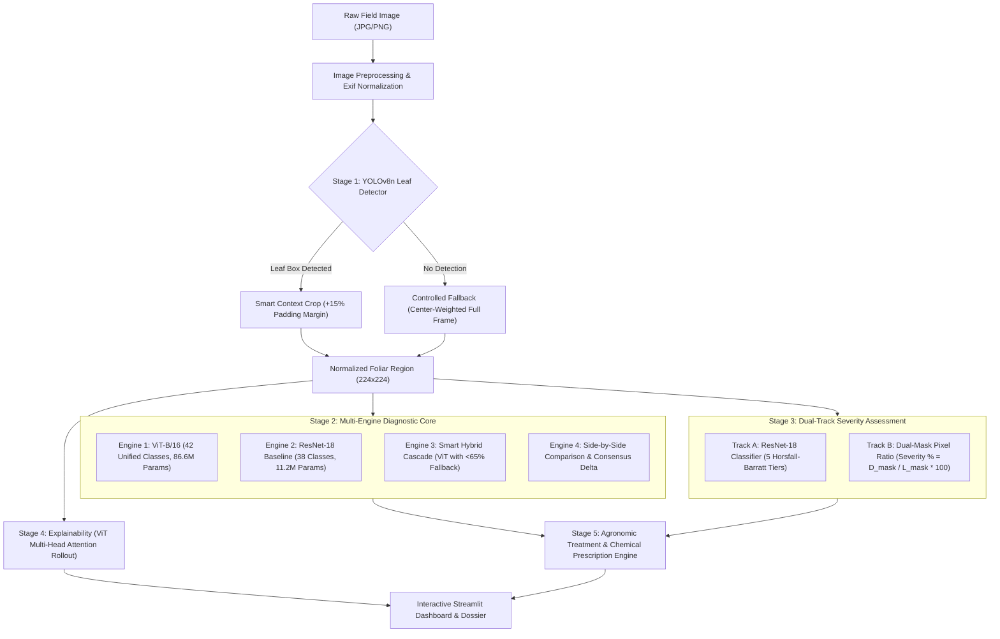

# 🌿 Precision Crop Pathology & Agronomic Decision Support System

> **An End-to-End Hierarchical Deep Learning and Vision Transformer Pipeline for Real-World Foliar Disease Localization, Diagnosis, Dual-Track Severity Grading, and Actionable Agronomic Prescriptions across 42 Pathological Classes and 15 Crop Species.**

[](https://www.python.org/)
[](https://pytorch.org/)
[](https://github.com/ultralytics/ultralytics)
[](https://arxiv.org/abs/2010.11929)
[](https://streamlit.io/)
[-success.svg?logo=github)](https://github.com/26piyush/Deep_Learning_Project/releases/tag/v1.0.0)

---

## 📋 Table of Contents
1. [Project Overview & Problem Statement](#-project-overview--problem-statement)
2. [End-to-End System Architecture](#-end-to-end-system-architecture)
3. [Component Breakdown & Technical Architecture](#-component-breakdown--technical-architecture)
   - [Stage 1: Hierarchical Localization (YOLOv8n)](#stage-1-hierarchical-localization-yolov8n)
   - [Stage 2: Multi-Dataset Foliar Diagnosis (ViT-B/16)](#stage-2-multi-dataset-foliar-diagnosis-vit-b16)
   - [Stage 3: Dual-Track Severity Assessment](#stage-3-dual-track-severity-assessment)
   - [Stage 4: Explainability via Attention Rollout](#stage-4-explainability-via-attention-rollout)
   - [Stage 5: Agronomic Prescription & Action Engine](#stage-5-agronomic-prescription--action-engine)
4. [Supported Crops & Disease Taxonomy (42 Classes / 15 Crops)](#-supported-crops--disease-taxonomy)
5. [Multi-Dataset Engineering & Zero Data Leakage](#-multi-dataset-engineering--zero-data-leakage)
6. [Empirical Experimental Results & Metrics](#-empirical-experimental-results--metrics)
7. [Repository File Structure](#-repository-file-structure)
8. [Installation & Quick Start Guide](#-installation--quick-start-guide)
9. [Model Weights & Checkpoints (Download Links)](#-model-weights--checkpoints)
10. [Model Evaluation Commands](#-model-evaluation-commands)
11. [Academic Defense & Viva Voce Guide](#-academic-defense--viva-voce-guide)

---

## 🎯 Project Overview & Problem Statement

### The Problem with Existing Agricultural AI
Most existing computer vision models for plant pathology suffer from severe architectural limitations that prevent practical field deployment:
1. **Background Overfitting (Shortcut Learning):** Standard Convolutional Neural Networks (CNNs) fed with raw field photographs learn spurious correlations with soil color, shadows, irrigation pipes, or human hands rather than true foliar symptoms.
2. **Absence of Leaf Localization:** Classifying a full scene without bounding the infected leaf tissue prevents targeted automated spraying and precision robotics.
3. **Missing Severity Quantification:** A simple diagnostic tag (*e.g., "Early Blight"*) does not tell the farmer whether the infection is an early spot or a critical epidemic. Practical agronomy requires **infection severity grading** to determine intervention urgency.
4. **Lab-to-Field Generalization Gap:** Models trained exclusively on clean laboratory leaves with neutral backgrounds (*e.g., PlantVillage*) fail catastrophically when evaluated against real-world in-situ field conditions (*e.g., PlantDoc*).

### The Proposed Hierarchical Solution
This project establishes a **5-stage modular, explainable pipeline**:
- **Filters Background Clutter:** YOLOv8 leaf localization discards up to 80% of irrelevant field background.
- **Smart Context Cropping:** Applies an intentional $+15\%$ padding margin to capture outer chlorotic halos and fungal rings without truncation.
- **Global Self-Attention Diagnosis:** Vision Transformers (`ViT-B/16`) capture long-range spatial relationships across distant lesion margins.
- **Dual-Track Severity:** Combines an agronomic 5-tier Horsfall-Barratt classifier with a continuous mathematical pixel necropsy metric ($\frac{D_{\text{mask}}}{L_{\text{mask}}} \times 100\%$).
- **Actionable Chemical Prescriptions:** Automatically maps identified pathogens and severity tiers to FRAC-coded active chemical dosages, biological controls, and cultural management strategies.

---

## 🏗️ End-to-End System Architecture

The complete system pipeline transitions raw camera input into a comprehensive pathology report:



---

## 🔬 Component Breakdown & Technical Architecture

### Stage 1: Hierarchical Localization (YOLOv8n)
* **Model:** Ultralytics YOLOv8n (nano variant, $\approx 3.2\text{M}$ parameters) trained on field bounding boxes.
* **Smart Context Padding:** Standard bounding boxes clip outer lesion halos. The pipeline applies a $+15\%$ dimensional boundary padding to preserve transitional symptoms:
  $$\text{Box}_{\text{padded}} = \left[ x_{\min} - 0.15\Delta_x,\; y_{\min} - 0.15\Delta_y,\; x_{\max} + 0.15\Delta_x,\; y_{\max} + 0.15\Delta_y \right]$$
* **Controlled Fallback:** If heavy occlusion or extreme camera angles result in zero YOLO detections ($N_{\text{boxes}} = 0$), the pipeline executes a safe fallback to the center-weighted frame, setting `used_fallback = True` without crashing.

```
       Raw Field Image                     Smart Context Crop (+15%)
┌─────────────────────────────┐        ┌─────────────────────────────┐
│   [Soil & Shadows]          │        │    ░░░░░░░░░░░░░░░░░░░░     │
│       ┌──────────────┐      │  ───►  │    ░ ┌──────────────┐ ░     │
│       │ Leaf Tissue  │      │        │    ░ │ Leaf Tissue  │ ░     │
│       │ & Halo Rings │      │        │    ░ │ & Halo Rings │ ░     │
│       └──────────────┘      │        │    ░ └──────────────┘ ░     │
│   [Weeds / Hand Grip]       │        │    ░░░░░░░░░░░░░░░░░░░░     │
└─────────────────────────────┘        └─────────────────────────────┘
```

---

### Stage 2: Multi-Dataset Foliar Diagnosis (ViT-B/16)
* **Architecture:** Vision Transformer Base (`ViT-B/16`), fine-tuned with ImageNet-1K pretrained weights using PyTorch Automatic Mixed Precision (AMP).
* **Specifications:** $86.6\text{M}$ parameters, $L = 12$ Transformer encoder layers, $h = 12$ attention heads, hidden dimension $D = 768$.
* **Patch Tokenization:**
  1. An input crop $x \in \mathbb{R}^{224 \times 224 \times 3}$ is partitioned into $N = \frac{224 \times 224}{16 \times 16} = 196$ non-overlapping patches.
  2. Patches are linearly projected to dimension $D = 768$.
  3. A learnable classification token $[x_{\text{class}}]$ is prepended, yielding $197$ total tokens.
  4. 1D learnable positional embeddings $E_{\text{pos}} \in \mathbb{R}^{197 \times 768}$ are added.
  5. Tokens pass through 12 Multi-Head Self-Attention (MSA) blocks:
     $$\text{Attention}(Q, K, V) = \text{Softmax}\left(\frac{QK^T}{\sqrt{d_k}}\right)V$$
     $$\text{MSA}(X) = [\text{head}_1, \dots, \text{head}_h]W^O$$
  6. The representation of the $[x_{\text{class}}]$ token is fed into the classification head to output the predicted class $\hat{y}$.

```
Input Leaf Crop (224×224×3)
      │
      ▼
┌──────────────┐   ┌──────────────┐       ┌──────────────┐
│ Patch 1 (16²)│   │ Patch 2 (16²)│  ...  │Patch 196(16²)│
└──────┬───────┘   └──────┬───────┘       └──────┬───────┘
       │ Linear Projection│                      │
       ▼                  ▼                      ▼
┌──────────────┐   ┌──────────────┐       ┌──────────────┐
│ Token 1 (768)│   │ Token 2 (768)│  ...  │Token 196(768)│  + [x_class] Token
└──────┬───────┘   └──────┬───────┘       └──────┬───────┘
       └──────────────────┬──────────────────────┘
                          │ + Positional Embeddings E_pos
                          ▼
            ┌────────────────────────────┐
            │ 12x Transformer Blocks     │
            │ • Multi-Head Attention     │
            │ • Layer Normalization      │
            │ • MLP (GELU Activation)    │
            └─────────────┬──────────────┘
                          │ Class Token Output z_L^0
                          ▼
             [ Linear Classification Head ]
                          │
                          ▼
           42-Class Softmax Probabilities
```

#### Diagnostic Engine Modes
| Engine Mode | Primary Backbone | Classes Covered | Behavior & Use-Case |
| :--- | :--- | :--- | :--- |
| **1. ViT-B/16 Unified** | Vision Transformer | 42 Classes (15 Crops) | Full multi-dataset engine trained on lab and field specimens. |
| **2. Crop Health ResNet** | ResNet-18 Residual CNN | 38 Classes (14 Crops) | Fast, lightweight baseline for comparison. |
| **3. Smart Hybrid Cascade**| ViT + ResNet Fallback | Dynamic | Uses ViT; if confidence $< 65\%$, escalates diagnosis to ResNet-18. |
| **4. Side-by-Side** | ViT vs. ResNet-18 | Comparative | Runs both models concurrently, reporting consensus and probability delta. |

---

### Stage 3: Dual-Track Severity Assessment
To bridge empirical agronomy and precision computer vision, severity is assessed using two parallel methodologies:

* **Track A — Discrete Pathological Classifier (ResNet-18):**
  Categorizes infection into 5 risk levels mapped to the **Horsfall-Barratt rating scale**:
  - `No Risk` (0% foliar damage)
  - `Very Low` (1% – 5% foliar damage)
  - `Low` (6% – 15% foliar damage)
  - `Medium` (16% – 35% foliar damage)
  - `High` (> 35% foliar damage, necrosis / severe defoliation risk)

* **Track B — Continuous Mathematical Pixel Ratio:**
  Generates binary masks separating the total leaf surface ($L_{\text{mask}}$) from necrotic lesion tissue ($D_{\text{mask}}$) to compute exact physical damage:
  $$\text{Severity \%} = \frac{\sum_{(x,y)} D_{\text{mask}}(x,y)}{\sum_{(x,y)} L_{\text{mask}}(x,y)} \times 100\%$$

---

### Stage 4: Explainability via Attention Rollout
To eliminate "black box" decisions, the pipeline extracts self-attention weight matrices across all 12 heads and layers:
1. Self-attention matrices $A_l$ are averaged across all heads:
   $$\bar{A}_l = \frac{1}{h} \sum_{i=1}^h A_{l,i}$$
2. Identity matrices are added to account for residual token skip-connections:
   $$\hat{A}_l = 0.5 \bar{A}_l + 0.5 I$$
3. Attention is recursively multiplied across all 12 layers:
   $$R = \prod_{l=1}^L \hat{A}_l$$
4. The class token row $R_{0, 1:N}$ is extracted, reshaped into a $14 \times 14$ grid, bilinearly interpolated back to $224 \times 224$, and overlaid as a heatmap highlighting the exact lesion spots that triggered the diagnostic decision.

---

### Stage 5: Agronomic Prescription & Action Engine
Based on the diagnosed pathogen, severity tier, and user-specified crop acreage, the system generates an immediate treatment plan:
- **FRAC-Coded Chemical Fungicides:** Systemic and contact fungicide recommendations (*e.g., Chlorothalonil 75% WP, Metalaxyl-M + Mancozeb, Difenoconazole*) with precise dilution rates (grams per liter).
- **Biological Controls:** Preventative bio-agents (*e.g., Bacillus subtilis, Trichoderma harzianum, Potassium Bicarbonate*).
- **Cultural Management:** Aeration, pruning, drip-irrigation transition, and crop debris disposal practices.
- **Application Schedule:** Exact spray intervals and urgency warnings based on whether severity is Low, Moderate, or High.

---

## 🌾 Supported Crops & Disease Taxonomy

The system supports **42 disease classes across 15 agricultural crops**:

| Crop Species | Supported Conditions |
| :--- | :--- |
| **🍎 Apple** | Apple Scab, Black Rot, Cedar Apple Rust, Healthy |
| **🫐 Blueberry** | Healthy |
| **🍒 Cherry** | Powdery Mildew, Healthy |
| **🌽 Corn (Maize)** | Cercospora Leaf Spot (Gray Leaf Spot), Common Rust, Northern Leaf Blight, Healthy |
| **🍇 Grape** | Black Rot, Esca (Black Measles), Leaf Blight (Isariopsis Leaf Spot), Healthy |
| **🍊 Orange** | Huanglongbing (Citrus Greening) |
| **🍑 Peach** | Bacterial Spot, Healthy |
| **🍐 Pear** | Pear Leaf Curl, Pear Healthy, Pear Slug Sawfly, Pear Leaf Spot *(DiaMOS)* |
| **🫑 Pepper (Bell)** | Bacterial Spot, Healthy |
| **🥔 Potato** | Early Blight, Late Blight, Healthy |
| **🍓 Raspberry** | Healthy |
| **🌱 Soybean** | Healthy |
| **🎃 Squash** | Powdery Mildew |
| **🍓 Strawberry** | Leaf Scorch, Healthy |
| **🍅 Tomato** | Bacterial Spot, Early Blight, Late Blight, Leaf Mold, Septoria Leaf Spot, Spider Mites (Two-spotted), Target Spot, Yellow Leaf Curl Virus, Mosaic Virus, Healthy |

---

## 📊 Multi-Dataset Engineering & Zero Data Leakage

To overcome the laboratory vs. field domain gap, three benchmark datasets were integrated:

```
                            ALL DATASETS (68,131 Images)
                                         │
        ┌────────────────────────────────┼────────────────────────────────┐
        ▼                                ▼                                ▼
[ PlantVillage ]                 [ PlantDoc ]                    [ DiaMOS Plant ]
• Controlled lab setting         • Real-world field images       • Real-world pear orchard
• 54,299 images                  • 7,906 leaf crops              • 5,926 leaf images
• 38 classes across 14 crops     • Cluttered backgrounds         • 4 disease classes + severity
        │                                │                                │
        └────────────────────────────────┼────────────────────────────────┘
                                         ▼
                      [ STRATIFIED UNIFIED PARTITIONING ]
                          (Fixed Random Seed: 42)
                                         │
        ┌────────────────────────────────┼────────────────────────────────┐
        ▼ (70%)                          ▼ (15%)                          ▼ (15%)
   TRAINING SET                     VALIDATION SET                    TEST SET
  (47,672 Images)                  (10,200 Images)                (10,259 Images)
  AdamW + AMP Tuning               Early Stopping Checkpoints     Held-Out Benchmark
```

### Zero Data Leakage Protocols
1. **Split-Before-Augment:** Dataset partitioning was performed strictly at the unique original image level prior to applying any geometric or photometric transforms.
2. **Hash-Verified Partitioning:** Manifest files store image hashes to ensure that no training image or cropped derivative ever appears in the test partition.
3. **Macro-Averaged Evaluation:** Macro F1 is prioritized over Micro F1 to prevent majority-class bias and evaluate rare diseases with equal rigor:
   $$\text{Macro F1} = \frac{1}{C}\sum_{c=1}^C \text{F1}_c$$

---

## 📈 Empirical Experimental Results & Metrics

All models were evaluated on dedicated held-out test splits on local hardware (NVIDIA GeForce RTX 4050 GPU):

| Model Component | Architecture | Test Dataset / Split | Accuracy | Macro F1 | Primary Metric |
| :--- | :--- | :--- | :---: | :---: | :---: |
| **Unified ViT Classifier** | ViT-B/16 (ImageNet-1K) | Unified Test Split (10,259 images) | **87.44%** | **86.13%** | Top-1 Accuracy |
| **ViT Pure Lab Benchmark** | ViT-B/16 | PlantVillage Held-Out Test (8,178 images) | **97.75%** | **96.99%** | Macro F1 |
| **ViT Solanaceae Subset** | ViT-B/16 | Review 2 Stratified Test Split (977 images) | **99.49%** | **99.46%** | Macro F1 |
| **Leaf Localization** | YOLOv8n | PlantDoc Test Annotations | — | — | **72.45% mAP@50** (0.467 IoU) |
| **Severity Assessment** | ResNet-18 | DiaMOS Discrete Severity Test Split | **66.53%** | **70.22%** | Macro F1 |

Evaluation curves, confusion matrices, and inference predictions are stored in [`results/`](results/).

---

## 📁 Repository File Structure

```text
Deep_Learning_Project/
├── app.py                      # Interactive Streamlit Web Application
├── run_app.bat                 # One-click Windows self-healing launcher
├── requirements.txt            # Python environment dependencies
├── README.md                   # Complete repository documentation
├── architecture.md             # In-depth architectural & viva defense guide
│
├── src/                        # Core Python pipeline package
│   ├── config.py               # Central paths, hyperparameters, and class mappings
│   ├── inference.py            # End-to-end 4-engine inference orchestrator
│   ├── train_vit.py            # ViT-B/16 training script with PyTorch AMP
│   ├── evaluate_vit.py         # ViT evaluation (Accuracy, Macro F1, Confusion Matrix)
│   ├── train_localization.py   # YOLOv8 leaf and lesion localization training
│   ├── evaluate_localization.py# YOLO evaluation (mAP@50, mean IoU)
│   ├── train_severity.py       # Horsfall-Barratt severity classifier training
│   ├── evaluate_severity.py    # Severity classifier evaluation & error analysis
│   ├── explainability.py       # ViT Multi-Head Attention Rollout engine
│   ├── segmentation.py         # Dual-mask leaf & necrosis pixel segmentation
│   ├── prescription.py         # Agronomic chemical & biological treatment engine
│   ├── knowledge_base.py       # Pathological taxonomy for 42 crop-disease classes
│   ├── dataset_utils.py        # Stratified dataset preparation & hash-split validation
│   ├── preprocessing.py        # Image validation, EXIF normalization & transforms
│   └── utils.py                # Reproducibility seeds, metrics & plotting helpers
│
├── models/                     # Production model checkpoints
│   ├── .gitkeep                # Preserves folder structure in Git
│   ├── vit_best.pt             # [Hosted in Release] 42-class ViT-B/16 checkpoint (327 MB)
│   ├── localization_best.pt    # [Hosted in Release] YOLOv8n leaf detector (5.9 MB)
│   └── severity_best.pt        # [Hosted in Release] 5-class severity classifier (42.7 MB)
│
├── crop_health_model/          # Standalone 38-class ResNet-18 inference module
│   ├── predictor.py            # CropHealthPredictor inference engine
│   ├── model_state.pt          # [Hosted in Release] ResNet-18 baseline weights (42.8 MB)
│   ├── model_meta.json         # Label mappings and normalization parameters
│   ├── api_server.py           # Standalone Flask microservice
│   └── example_usage.py        # Quick CLI predictor example
│
├── testing_data/               # Curated 190-image benchmark verification suite
│   ├── labels.csv              # Ground-truth annotations for all test images
│   ├── manifest.json           # Machine-readable test dataset metadata
│   └── README.md               # Guide to running inference on the test suite
│
├── results/                    # Experimental figures, confusion matrices & metrics
│   ├── figures/                # Training curves, confusion matrices, Grad-CAM overlays
│   ├── metrics/                # Evaluated metrics JSON files
│   └── predictions/            # Visual prediction evidence and validation samples
│
└── notebooks/                  # Interactive experimentation & Colab notebooks
    └── Severity_Training.ipynb # Severity model training notebook
```

---

## 🚀 Installation & Quick Start Guide

### Option A — One-Click Windows Launch (Recommended)
Simply double-click **`run_app.bat`**.  
The script automatically:
1. Checks for a Python 3.10+ installation.
2. Creates the `.venv` virtual environment if missing.
3. Automatically installs all dependencies from `requirements.txt`.
4. Checks for model checkpoints in `models/` and gives helpful guidance.
5. Launches the interactive Streamlit dashboard.

---

### Option B — Manual Terminal Setup

```bash
# 1. Clone the repository
git clone https://github.com/26piyush/Deep_Learning_Project.git
cd Deep_Learning_Project

# 2. Create and activate virtual environment
python -m venv .venv

# On Windows (PowerShell):
.\.venv\Scripts\Activate.ps1
# On Windows (Command Prompt):
.\.venv\Scripts\activate.bat
# On Linux / macOS:
source .venv/bin/activate

# 3. Upgrade pip and install dependencies
python -m pip install --upgrade pip
pip install -r requirements.txt

# 4. Launch the Streamlit application
streamlit run app.py
```

The web dashboard will be available at `http://localhost:8501`.

---

## 📦 Model Weights & Checkpoints

Due to GitHub's 100 MB single-file repository limit, trained model checkpoints are securely hosted on [GitHub Releases (Release v1.0.0)](https://github.com/26piyush/Deep_Learning_Project/releases/tag/v1.0.0).

Download the weights and place them into their designated local directories:

| Model Checkpoint | File Size | Destination Path | Direct Download Link |
| :--- | :---: | :--- | :--- |
| **`vit_best.pt`** | 327.48 MB | `models/vit_best.pt` | [Download `vit_best.pt`](https://github.com/26piyush/Deep_Learning_Project/releases/download/v1.0.0/vit_best.pt) |
| **`localization_best.pt`** | 5.93 MB | `models/localization_best.pt` | [Download `localization_best.pt`](https://github.com/26piyush/Deep_Learning_Project/releases/download/v1.0.0/localization_best.pt) |
| **`severity_best.pt`** | 42.72 MB | `models/severity_best.pt` | [Download `severity_best.pt`](https://github.com/26piyush/Deep_Learning_Project/releases/download/v1.0.0/severity_best.pt) |
| **`model_state.pt`** | 42.78 MB | `crop_health_model/model_state.pt` | [Download `model_state.pt`](https://github.com/26piyush/Deep_Learning_Project/releases/download/v1.0.0/model_state.pt) |

*(Note: If you run `app.py` before downloading the weights, the web dashboard opens safely with helpful download reminders).*

---

## 🔬 Model Evaluation Commands

Run standalone evaluation scripts from your activated virtual environment:

```bash
# Evaluate Vision Transformer (Accuracy, Macro F1, Confusion Matrix)
python -m src.evaluate_vit

# Evaluate YOLOv8 Leaf Localization (mAP@50, Mean IoU)
python -m src.evaluate_localization

# Evaluate Severity Classifier (Horsfall-Barratt metrics)
python -m src.evaluate_severity

# Run inference on a sample test leaf from CLI
python -m src.inference --image testing_data/Tomato___Early_blight_01.jpg --classifier vit
```

---

## 🎓 Academic Defense & Viva Voce Guide

For detailed technical formulations, architectural comparisons (Current vs. Final Phase), and answers to top professor viva voce questions (*e.g., ViT vs. CNN receptive fields, transfer learning mechanics, and data leakage elimination*), please consult the complete defense documentation:

👉 **[Comprehensive Architecture & Faculty Viva Defense Guide (architecture.md)](architecture.md)**

---

## 📄 License & Attribution
This project is developed for academic research and evaluation in precision agriculture and computer vision. Datasets utilized are credited to the **PlantVillage Project**, **PlantDoc (IIT Roorkee / CVPRW)**, and **DiaMOS Plant (University of Milan)**.
